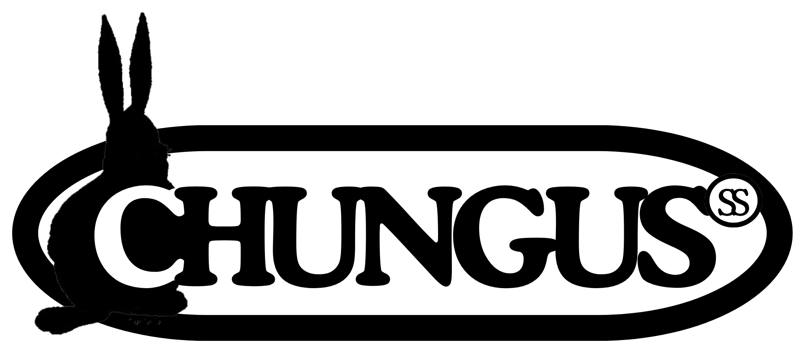
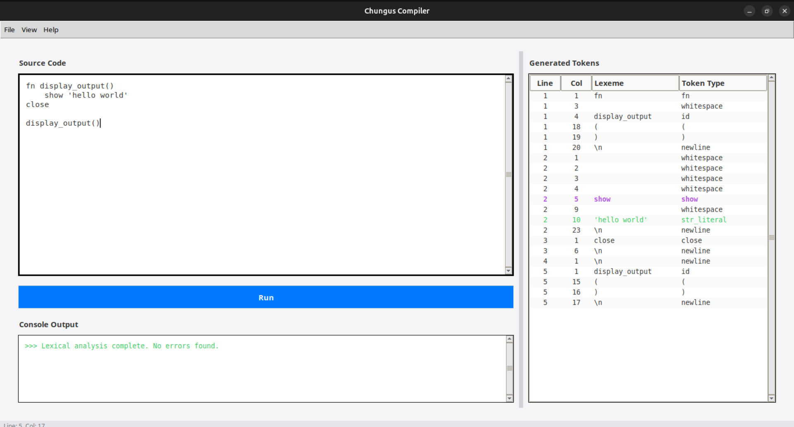

<p align="center">
  
</p>

# CHUNGUS Language
A clean, minimal, general programming language.

## Introduction

**CHUNGUS** is a small, dynamically typed language with a friendly, readable syntax.
Programs are written in `.chg` files and compiled by a Python-based compiler that
generates C, which is then built and run with the CHUNGUS runtime library.

### Hello, CHUNGUS

```
# Recursive factorial
fn fact(n):
    result = 1;
    if n > 1:
        result = n * fact(n - 1);
    close
    ret result;
close

nums : [3] = [3, 4, 5];

for i in range(0, 3, 1):
    n = nums[i];
    f = fact(n);
    show 'fact('; show n; show ') = '; show f; show '\n';
close
```

Output:

```
fact(3) = 6
fact(4) = 24
fact(5) = 120
```

### Language at a glance

| Feature | Syntax |
| --- | --- |
| Comments | `# single line`, `### multi-line ###` |
| Variables | `x = 10;` (no type declarations; types are inferred) |
| Types | `int`, `float`, `str` (`'single quotes'`), `bool` (`true` / `false`) |
| Output / input | `show x;` &nbsp;·&nbsp; `x = read;` |
| Arrays (1D / 2D) | `arr : [5] = [1, 2, 3, 4, 5];` &nbsp;·&nbsp; `mat : [2][3] = [[1, 2, 3], [4, 5, 6]];` |
| Conditionals | `if cond: ... elif cond: ... else: ... close` |
| Loops | `while cond: ... close` &nbsp;·&nbsp; `for i in range(start, stop, step): ... close` |
| Functions | `fn name(a, b): ... ret value; close` |
| Arithmetic | `+  -  *  /  //` (floor div) `%  **` (power) |
| Comparison / logic | `==  !=  <  >  <=  >=` &nbsp;·&nbsp; `and  or  !` |
| Type casts | `int(x)`, `float(x)` |
| Built-ins | `length(x)`, `type(x)`, `compare(a, b)`, `str_to_arr(s)`, `arr_to_str(a)` |
| Placeholder | `todo;` |

Key rules:
- Every statement ends with `;`.
- Every block (`fn`, `if`, `while`, `for`) opens with `:` and ends with `close`.
- `show` prints a variable or string literal; store expressions in a variable first.

More examples live in [`samples/`](samples/).

### How it works

<p align="center">
  
</p>

`.chg` source → **Lexer** (tokens) → **Parser** (AST) → **Semantic analysis** → **C code generation** → **Compile & run**

## Quick start
1. Create and activate a venv
   - Bash (Linux):
    ```sh
    python3 -m venv .venv
    source .venv/bin/activate
    ```
   - Bash (Windows):
    ```sh
    python3 -m venv .venv
    source .venv/Scripts/activate
    ```
   - PowerShell:
    ```ps
    python -m venv .venv
    .venv\Scripts\Activate.ps1
     ```
   - CMD:
    ```cmd
    python -m venv .venv
    .venv\Scripts\activate.bat
    ```

2. Install dependencies
   - Bash:
     ```sh
      python3 -m pip install pip-tools
      pip-compile requirements-dev.in
      python3 -m piptools sync requirements-dev.txt
     ```
   - PowerShell / CMD:
     ```sh
      python -m pip install pip-tools
      pip-compile requirements-dev.in
      python -m piptools sync requirements-dev.txt
     ```


## Running the project

### Full Pipeline (Compile & Run)

**Recommended for most users** - runs all compilation phases and executes the program:

- **GUI** (All phases with visual interface)
  ```sh
  python -m src.main
  ```
- **CLI**: 
  ```sh
  python -m src <file.chg>
  python -m src samples/program1.chg      # Example
  ```

This will:
1. Tokenize the source (Lexer)
2. Parse and generate AST (Syntax)
3. Type check and validate (Semantic)
4. Generate C code in `output/` (Codegen)
5. Compile and execute (Runtime)

### Individual Phase CLIs

Run specific compilation phases for debugging or testing:

- **Lexer** (Tokenization only)
  - macOS / Linux: `python3 -m src.lexer [file.chg]`
  - Windows: `python -m src.lexer [file.chg]`
  - Uses `input_lexer.chg` if no file specified

- **Parser** (Syntax analysis only)
  - macOS / Linux: `python3 -m src.syntax [file.chg]`
  - Windows: `python -m src.syntax [file.chg]`
  - Uses `input_syntax.chg` if no file specified

- **Semantic** (Type checking only)
  - macOS / Linux: `python3 -m src.semantic [file.chg]`
  - Windows: `python -m src.semantic [file.chg]`
  - Uses `input_semantic.chg` if no file specified

- **Codegen** (Generate C code only, no execution)
  - macOS / Linux: `python3 -m src.codegen [file.chg]`
  - Windows: `python -m src.codegen [file.chg]`
  - Uses `input_codegen.chg` if no file specified
  - Output saved to `output/`

- **Runtime** (Compile and run C code)
  - macOS / Linux: `python3 -m src.runtime <file.c>`
  - Windows: `python -m src.runtime <file.c>`
  - Compiles C with CHUNGUS runtime library and executes

### Docker

- Build image (uses [Dockerfile](Dockerfile))
  ```sh
  docker build -t chg-compiler .
  ```

- Run full pipeline
  ```sh
  docker run --rm -it chg-compiler python -m src samples/program1.chg
  ```

- Run individual phase CLIs
  ```sh
  docker run --rm -it chg-compiler python -m src.lexer
  docker run --rm -it chg-compiler python -m src.syntax
  ```

- GUI in Docker
  ```sh
  *Currently not supported
  ```

### ### Testing

- Run all tests:
  ```sh
  pytest -q
  ```
- Run a single test file:
  ```sh
  pytest -q test/lexer/test_lexer_tokens.py
  ```

### ### Linting

- Run flake8 over the codebase:
  ```sh
  flake8 .
  ```
  Project config lives in [.flake8](.flake8).

### Memory Leaks Check

- Check for memory leaks (requires valgrind)
  ```sh
  valgrind --leak-check=full ./output/program
  ```

### Output Directory

All generated files are saved to `output/`:
- `*.c` - Generated C source files
- `*` (no extension) - Compiled executables

Clean output directory:
```sh
rm -rf output/
```

## How to contribute in project?
- Create branch, run tests locally, open PR.
- Follow flake8 style rules; run `flake8` before PR.